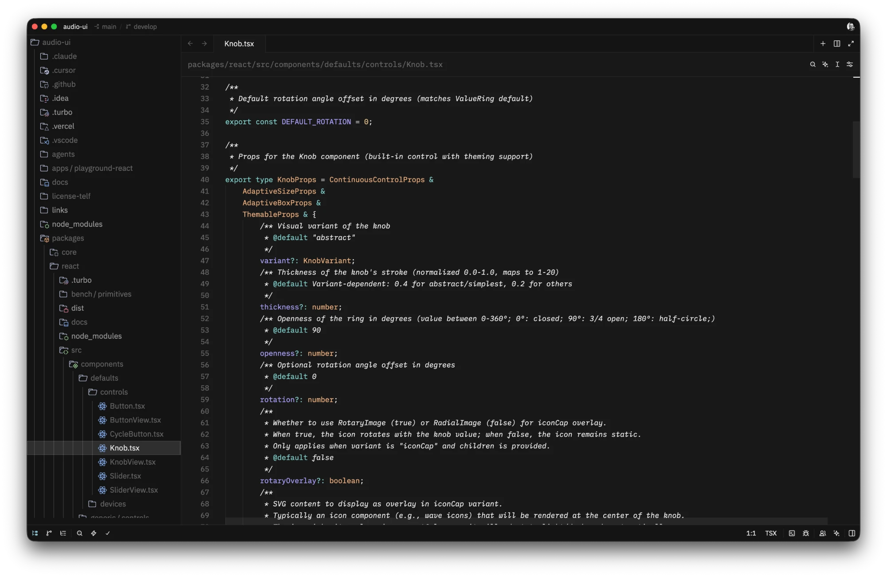
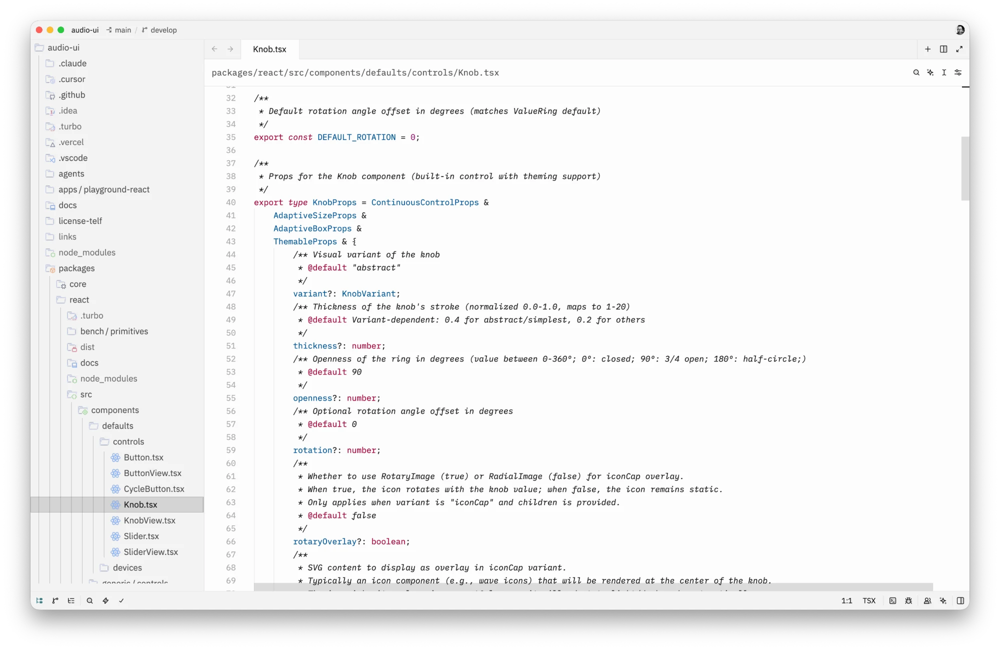

# Cursor themes for Zed

Cursor Dark and Cursor Light for [Zed](https://zed.dev), generated from the
themes that ship with Cursor, so they look the way Cursor looks today.

The Cursor Theme extension in Zed's registry has a dark theme only. These two
are built from Cursor's own theme files by a script you can run again when
Cursor changes its colours.





## Install

This extension is not in Zed's registry. To install it:

1. Clone this repository.
2. In Zed, run `zed: install dev extension` and pick the cloned folder.
3. Pick "Cursor Dark" or "Cursor Light" with `theme selector: toggle`
   (`cmd-k cmd-t` on macOS).

The Cursor Theme extension also has a theme named "Cursor Dark". If you have
it installed, uninstall it so that you know which one Zed shows.

## Rebuild from your Cursor

`build.py` reads the theme files inside Cursor and writes `themes/cursor.json`.
It needs Python 3 and nothing else.

```sh
python3 build.py              # reads /Applications/Cursor.app (macOS)
python3 build.py PATH         # or the folder holding Cursor's theme files
python3 build.py --check      # also checks the theme keys against Zed's source
```

Every colour comes from Cursor's files. The script only decides which Cursor
colour goes to which part of Zed, following the rules of Zed's own importer
for VS Code themes. This version was built from Cursor 3.25.6.

## Licence

MIT, for the script and the theme file. Cursor is a trademark of Anysphere,
Inc. This project is not affiliated with Anysphere.
